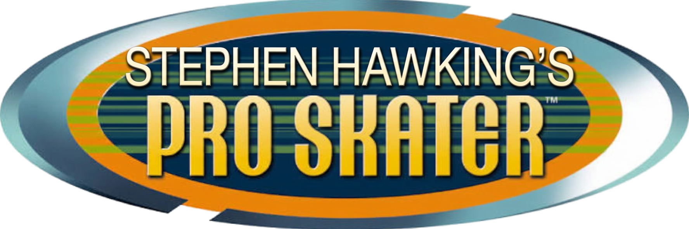

<p align="center"></p>

*Tony Hawk's Pro Skater* (PlayStation, 1999) with one more skater: Stephen Hawking, a professor in a
powered wheelchair, who rides it like a board. Kickflips, grinds and bails all happen in the chair,
and he speaks a few of his own lines. A wheelchair doesn't stop anyone going above and beyond.

It's a mod for [TonyWasAProSkater](https://github.com/LANCommander/TonyWasAProSkater), the native
PC port of the game, plus one small patch to that port. **No game files are included**: you need
your own copy of the game (see [NOTICE.md](NOTICE.md)).

## Playing

```sh
git clone --recursive https://github.com/bashalarmistdecomp/stephen-hawking-pro-skater.git
cd stephen-hawking-pro-skater
./play.sh
```

`play.sh` is the one command. It checks what's missing and tells you how to get it, then does
the rest:
1. patches and builds the game (it offers to fetch the one Ghidra file the build needs);
2. copies the game's data off your disc, once;
3. builds the mod and installs it;
4. starts the game.

**Your disc:** *Tony Hawk's Pro Skater* for the PlayStation (USA, SLUS-00860), as a raw disc
image: a `.bin` (MODE2/2352) and its `.cue`, or a `.zip` of them. Give it to `play.sh` in any of
these ways:
- put it in `ref/` (any name);
- run `./play.sh --disc FILE`;
- drag it into the terminal when `play.sh` asks.

Stephen Hawking is the last skater on the select screen: press Left from Tony Hawk.

`./play.sh --check` only reports what's ready and what's missing. `./play.sh --install-desktop`
adds the game to your app menu. `./play.sh --help` has the rest.

### Requirements

**Linux on x86-64** is what this is made and tested on. The port also builds on Windows, and the
mod and patch aren't specific to Linux, but `play.sh` is a bash script, and Windows is untested.

- git and Python 3.
- What the port's build needs: GCC and G++ with 32-bit (multilib) support, pkg-config and SDL2.
  `play.sh` prints the install command for Arch, Debian/Ubuntu and Fedora.
- Ghidra's GNU demangler. `play.sh` offers to fetch it.
- Optional:
  - espeak-ng and ffmpeg, to make new voice lines;
  - Blender, to remake the model from its sources;
  - ffmpeg with NVENC, PipeWire and XWayland, for `./play.sh --record`.

## What's here

| | |
|---|---|
| `play.sh` | The one command: it sets up, builds and plays. `--record` also records the game. |
| `TonyWasAProSkater/` | The port, a git submodule pinned to an upstream commit. |
| `patches/` | `skater-voice.patch`, the one engine change the mod needs (per-skater voice lines), and `refresh.sh`, which rewrites the patch from the submodule. |
| `assets/models/` | The source models (from Meshy) and `source-hawking.png`, the image the professor was made from. |
| `assets/baked/` | The prepared model: the source models posed, joined, decimated and textured for the game. The mod is built from it. |
| `assets/voice/` | His voice clips. |
| `pipeline/` | Builds the mod, makes voice lines, and (with Blender) prepares the model. See [pipeline/README.md](pipeline/README.md). |

Two folders are never committed. `build/` holds everything generated. `ref/` is for your own
local files: disc images, recordings.

The mod itself is built on your machine, from `assets/baked/` and the game's data. Building it
needs no Blender. It can't be shipped ready-made, because it carries Tony Hawk's animations from
your copy of the game.

## His voice

His lines are synthesized with [espeak-ng](https://github.com/espeak-ng/espeak-ng)'s Klatt
formant voice, then shaped with [ffmpeg](https://ffmpeg.org) to the narrow band of old speech
hardware. It isn't his real voice. The clips are in `assets/voice/`, so espeak-ng and ffmpeg are
needed only to make new ones.

Try any line:

```sh
python3 pipeline/make_voice.py --say "Look up at the stars and not down at your feet."
```

It plays the line and saves it in `build/voice/`. To put a line in the game, edit
`pipeline/finish.json`:
1. Under `voice.lines`, add it with a short name:
   `"feet": "Look up at the stars and not down at your feet."`
2. Add that name to one of the moments under `voice.events`:

| Event | When a line plays |
|---|---|
| `Start` | when a run starts |
| `Trick` | when a trick scores: `TrickChance` percent of the time, at least `Gap` seconds after the last line |
| `Bail` | when he bails |
| `AfterBail` | after the bail line, `AfterBailChance` percent of the time |

Where a moment lists several lines, one is picked at random. Then run `./play.sh`: it makes the
new clip and rebuilds the mod. `voice.espeak.args` and `voice.filter` change the voice itself.

## The engine patch

The port has no per-skater voice, so `patches/skater-voice.patch` adds one:
- a `[Voice]` section in a mod skater's ini;
- the code that plays its lines at the right moments;
- a voice track in the mixer.

`play.sh` applies the patch to the submodule's working tree the first time and rebuilds the game.
The submodule is set to `ignore = dirty`, so the applied patch doesn't show up in `git status`.

To change the engine, edit the code in `TonyWasAProSkater/`, then:

```sh
patches/refresh.sh        # rewrites patches/skater-voice.patch from the submodule's changes
git add patches/
```

To move to a newer port:

```sh
git -C TonyWasAProSkater apply -R ../patches/skater-voice.patch        # take the patch off
git submodule update --remote TonyWasAProSkater
git -C TonyWasAProSkater apply --3way ../patches/skater-voice.patch    # resolve any conflicts
patches/refresh.sh
git add TonyWasAProSkater patches/
```

## License

MIT, © 2026 Bash Alarmist. See [LICENSE](LICENSE). [NOTICE.md](NOTICE.md) covers the game, the
port, the voice and the models.

## Tools used and attributions

- [TonyWasAProSkater](https://github.com/LANCommander/TonyWasAProSkater) by LANCommander: the
  decompiled PC port of the game that this mod is for (MIT).
- [MiniMax](https://www.minimax.io) H3 Ref2VA, via [ComfyUI](https://www.comfy.org): made the A-pose
  of Stephen Hawking (`assets/models/source-hawking.png`).
- [Meshy](https://www.meshy.ai) Image to 3D: made the Stephen Hawking and wheelchair models.
- [Blender](https://www.blender.org): prepares the models for the game.
- [espeak-ng](https://github.com/espeak-ng/espeak-ng) and [ffmpeg](https://ffmpeg.org): his voice
  lines.
- [Ghidra](https://github.com/NationalSecurityAgency/ghidra)'s GNU demangler: run by the port's
  build.
- [Claude Code](https://claude.com/claude-code): used for development.
